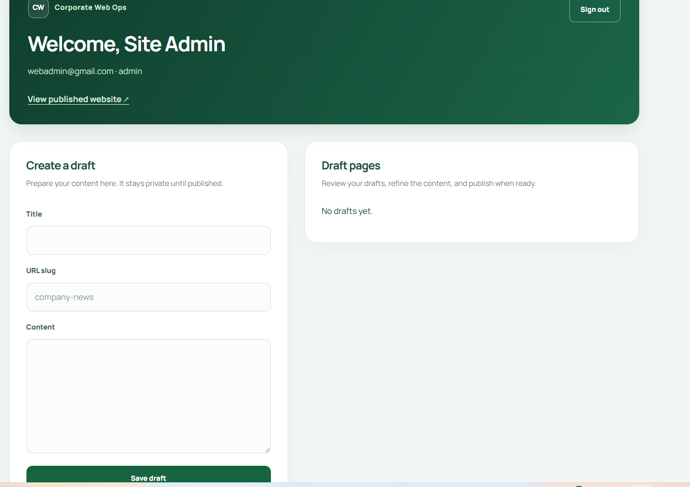
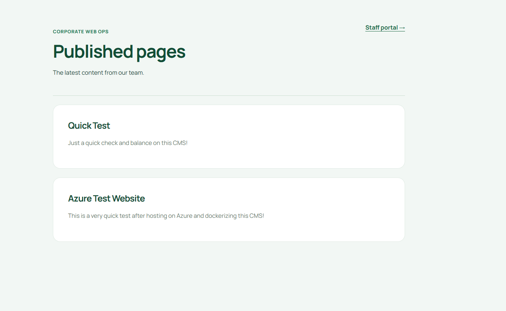
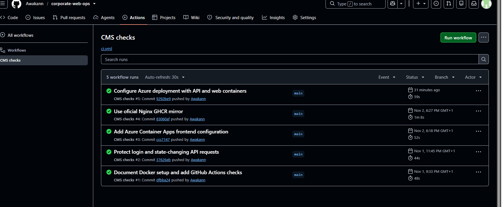

# Corporate Web Ops & CMS

A full-stack content management system deployed on Azure, with authenticated staff access, role-based publishing, and public pages.

Built to demonstrate web development, containerization, cloud deployment, and operational troubleshooting.

## Live Application

- [Public website](https://ca-corporate-web-ops.lemonwater-0d1d9cfb.eastus.azurecontainerapps.io/site)
- [Staff portal](https://ca-corporate-web-ops.lemonwater-0d1d9cfb.eastus.azurecontainerapps.io/)
- [API health](https://ca-corporate-web-ops.lemonwater-0d1d9cfb.eastus.azurecontainerapps.io/api/health)

Staff access requires an account. No public admin credentials are provided.

**Demo availability:** Atlas network access is currently temporary. When its access-list entry expires, database-backed features become unavailable. With scaling to zero enabled, the first request after inactivity may take longer.

## Screenshots

### Staff Dashboard



### Published Page



### GitHub Actions



## Features

- Session-based authentication with login, logout, and session restoration.
- Draft creation and content editing.
- Role-based publishing with confirmation.
- Public pages with individual URL slugs.
- Responsive React interface.
- Login throttling and origin validation for state-changing requests.
- Local Docker Compose environment.
- Azure deployment with managed identity and application secrets.

## Technology

| Area | Tools |
| --- | --- |
| Frontend | React, Vite, React Router |
| Backend | Node.js, Express, Mongoose |
| Database | MongoDB, MongoDB Atlas |
| Containers | Docker, Docker Compose |
| Web server | Nginx |
| Cloud | Azure Container Apps, Azure Container Registry |
| CI | GitHub Actions |

## Roles

| Action | Admin | Editor | Reviewer |
| --- | --- | --- | --- |
| View drafts | Yes | Yes | Yes |
| Create drafts | Yes | Yes | No |
| Edit draft content | Yes | Yes | No |
| Publish drafts | Yes | No | Yes |

Permissions are enforced by the API.

## Architecture

### Local Development

- Nginx serves the compiled React application and forwards `/api` requests to Express.
- Docker Compose runs Nginx, Express, and MongoDB.
- MongoDB stores users, pages, and sessions.
- A named Docker volume preserves local database data.
- Health checks control service startup order.

### Azure Deployment

- Azure Container Registry stores versioned frontend and API images.
- Azure Container Apps runs Nginx and Express as two containers in one app.
- HTTPS ingress forwards requests to Nginx on port 8080.
- Nginx forwards `/api` requests to Express through localhost on port 5000.
- MongoDB Atlas stores application data and sessions.
- A user-assigned managed identity has registry-scoped `AcrPull` access.
- The database URI and session secret are stored as Container Apps secrets.
- The deployment configuration limits scaling to one replica and supports scaling to zero.

## Run Locally

### Requirements

- Docker Desktop with Docker Compose.
- Node.js 24 and npm for development outside Docker.

From a fresh checkout, create the environment file:

```powershell
Copy-Item server/.env.example server/.env
```

Replace the `SESSION_SECRET` placeholder with a unique random value. Keep the environment file private.

Start the application:

```powershell
docker compose up -d --build
docker compose ps
```

| Address | Purpose |
| --- | --- |
| http://localhost:8080 | Staff portal |
| http://localhost:8080/site | Public website |
| http://localhost:8080/api/health | API health |

Local Compose uses HTTP and development session settings. Azure uses HTTPS and production session settings.

## Create the First Local Admin

There is no default password. Run in PowerShell:

```powershell
$env:ADMIN_EMAIL = Read-Host "Admin email"
$adminSecure = Read-Host "Admin password (at least 12 characters)" -AsSecureString
$env:ADMIN_PASSWORD = [System.Net.NetworkCredential]::new("", $adminSecure).Password

docker compose run --rm -e ADMIN_EMAIL -e ADMIN_PASSWORD api node seedAdmin.js

Remove-Item Env:ADMIN_EMAIL, Env:ADMIN_PASSWORD
Remove-Variable adminSecure
```

The seed script creates the initial admin only if one does not already exist.

Local MongoDB and cloud Atlas are separate databases. Accounts created locally are not automatically available in Azure.

## Azure Configuration

`containerapp.azure.yaml` defines the web and API containers, environment variables, health probes, and replica limits.

It references two existing secrets:

| Secret | API environment variable |
| --- | --- |
| `mongodb-uri` | `MONGODB_URI` |
| `session-secret` | `SESSION_SECRET` |

To update the existing Azure app:

```powershell
az containerapp update --name ca-corporate-web-ops --resource-group rg-corporate-web-ops --yaml containerapp.azure.yaml
```

This command requires the existing environment, registry access, identity, and application secrets. The YAML is an application update configuration, not a complete infrastructure provisioning template.


## Infrastructure as Code

The `infra/` directory contains four Azure Bicep templates covering the container registry, Container Apps environment, managed identities, GitHub OIDC trust, scoped role assignments, and Container App configuration.

All four templates were compiled, previewed with Azure What-If, and applied to the existing environment. After deployment, the health endpoint responded successfully and the API returned existing published pages from MongoDB Atlas.

GitHub Actions handles application releases. The Bicep templates capture the existing infrastructure; provisioning a fresh subscription from scratch has not been tested.


## Verification

### Automated CI Checks

GitHub Actions checks:

- Frontend linting and production build.
- Local Docker image builds and service startup.
- API health through Nginx.
- Public API and website responses.
- Origin validation for state-changing requests.
- API integration tests using Node’s test runner, Supertest, and an isolated local MongoDB database.
- Tests cover protected routes, origin validation, login/logout, role permissions, draft privacy, publishing, and duplicate slugs.
- Deployment runs only after verification passes on main.

### Manual Azure Verification

Verified after deployment:

- Login and session persistence after refresh.
- Draft creation and editing.
- Publishing and public-page visibility.
- Logout.
- API health and database reads.

GitHub Actions automatically deploys commits on main after verification passes. Deployment uses Azure OIDC authentication, commit-tagged container images, revision-readiness checks, and deployed endpoint checks. Additional validation, rate-limit, and error-handling tests are planned.

## Troubleshooting Experience

| Issue | Diagnosis and resolution |
| --- | --- |
| API failed inside Linux container | Corrected model import filename casing |
| Image downloads and Azure commands failed | Investigated DNS resolution and network connectivity |
| Public endpoint returned 502 | Inspected API startup logs behind Nginx |
| MongoDB rejected the URI | Corrected the saved connection-string format |
| Atlas authentication failed | Corrected database credentials and restarted the revision |
| Local network blocked verification | Used Azure Cloud Shell to test independently |

## Useful Commands

View local logs:

```powershell
docker compose logs --tail 80 api web
```

Rebuild local services:

```powershell
docker compose up -d --build
```

Stop local services while preserving database data:

```powershell
docker compose down
```

View cloud API logs:

```powershell
az containerapp logs show --name ca-corporate-web-ops --resource-group rg-corporate-web-ops --container api --type console --tail 50
```

Cloud console logs require an available replica.

## Project Structure

- `client/` — React frontend, Dockerfile, and Nginx configurations.
- `server/` — Express API, models, Dockerfile, and account scripts.
- `.github/workflows/ci.yml` — Automated CI checks.
- `compose.yaml` — Local container orchestration.
- `containerapp.azure.yaml` — Azure application update configuration.

For frontend development instructions, see [client/README.md](client/README.md).

## Planned Improvements

- API tests for authentication, permissions, and publishing.
- Monitoring, cost alerts, and a durable database network-access setup.